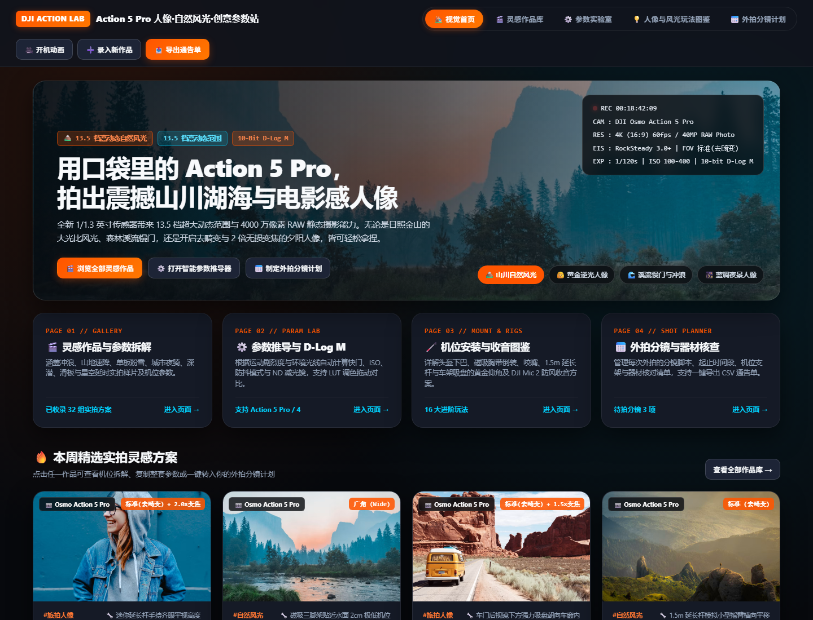
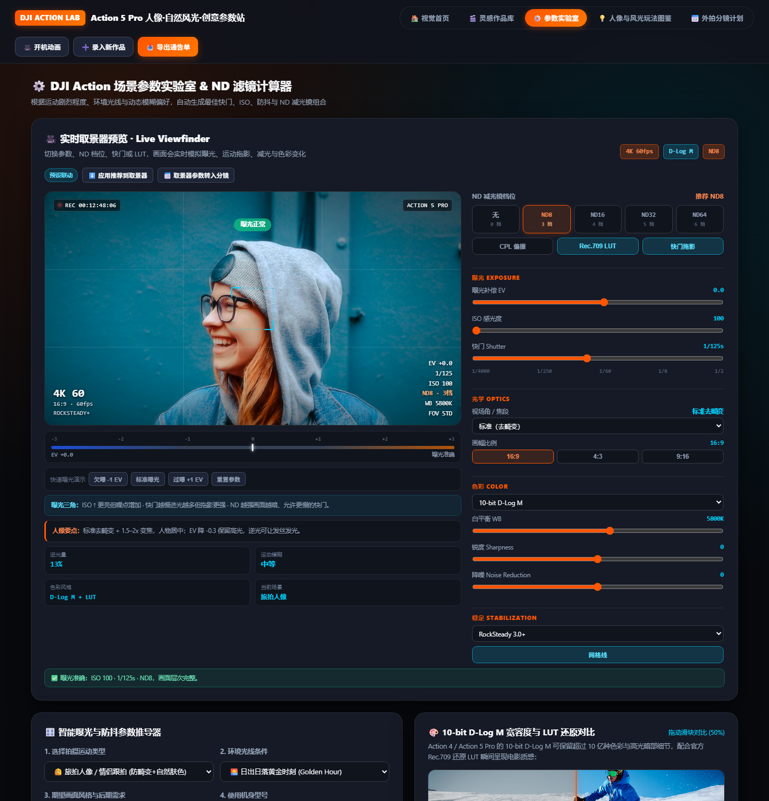

# DJI Action Lab · 摄影灵感与参数工作站

一个**单文件、零依赖**的 DJI Osmo Action 5 Pro 摄影工作站：把「灵感样片 + 曝光参数推演 + 现场取景模拟 + 外拍分镜计划」放在同一个网页里，浏览器直接打开就能用，不需要装任何软件。



## 五大页面

| 页面 | 能做什么 |
| --- | --- |
| 视觉首页 | 开机取景器动画、4 大入口、精选实拍方案速览 |
| 灵感作品库 | 32 组实拍方案（旅拍人像 / 自然风光 / 延时创意 / 水上运动），可搜索、按分类筛选、查看机位拆解、一键复制参数或转入分镜 |
| 参数实验室 | 实时取景器预览 + 智能参数推导 + 10-bit D-Log M 与 LUT 对比 |
| 玩法图鉴 | 16 大进阶玩法（人像不畸变、慢门丝绸、延时、电影级收音……），每条含安装角度、画幅防抖、收音配置与实战心法 |
| 外拍分镜计划 | 分镜清单、时间段、机位、曝光参数、器材核查表，支持主题模板一键载入、CSV 通告单导出、数据备份与导入 |

## 实时取景器预览

参数实验室顶部是核心玩法：改参数，画面立刻给出真实反馈。



- **曝光**：曝光补偿 EV `-2 ~ +2`、ISO `100–12800`、快门 `1/4000 ~ 1/2`
- **画面反馈**：过曝/欠曝提示、EV 测光条、高 ISO 噪点、慢门运动拖影、白平衡冷暖偏移
- **光学**：155° 超广角 / 广角 / 标准去畸变 / 2x 变焦，16:9 · 4:3 · 9:16 画幅
- **色彩**：10-bit D-Log M / HLG / Normal，白平衡 2500–8500K，锐度、降噪、Rec.709 LUT 开关
- **稳定**：关闭防抖（模拟手持抖动）、RockSteady、RockSteady 3.0+、HorizonSteady 360°、地平线校正 ±45°
- **滤镜**：ND8 / ND16 / ND32 / ND64、CPL 偏振、快门拖影开关、网格线

## 参数联动规则

- 取景器与推荐器共用**同一套曝光基准**：晴天电影感两处都推荐 `ND32`，黄金时刻都是 `ND8`，不会再出现两个答案打架。
- 一旦你手动调整取景器（EV / ISO / 快门 / ND / WB / FOV / 画幅），下方下拉框**不会覆盖**你的参数，取景器右上角会显示「手动调整」；点「⬇️ 应用推荐到取景器」可恢复联动。
- 「📅 取景器参数转入分镜」会把当前取景器状态（画幅、快门、ISO、ND、WB、EV、色彩、防抖、视角）写进分镜计划。

## 数据与输出

- 所有作品、分镜、器材清单保存在浏览器 `localStorage`，录入新作品后自动生成动态分类筛选
- 「💾 备份全部数据」导出 JSON，「📥 导入备份」在另一台电脑上恢复
- 「📤 导出通告单」导出带 BOM 的 CSV，Excel 直接打开不乱码
- 「🖨️ 打印当前页」只打印当前页面，自动切换浅色打印主题，A4 排版

## 快速开始

1. 下载或克隆本仓库
2. 双击 `index.html`，用 Chrome / Edge / Safari 打开即可
3. 想放到网上，直接把 `index.html` 传到任意静态托管（GitHub Pages、Vercel、Netlify）即可，无需后端

## 目录结构

```
dji-action-photo-lab/
├── index.html      # 整个工作站（HTML + CSS + JS 单文件）
├── assets/         # README 配图
└── README.md
```

## 说明

- 演示素材使用 Unsplash 在线图片，**需要联网**才能看到实拍图；断网时会自动显示内置占位图，其余功能不受影响
- 本工具是拍摄前的**参数推演与计划助手**，不会连接或控制真实相机
- 数据只存在你自己的浏览器里，不上传任何服务器

## 快捷键

- `Esc`：关闭当前弹窗
- `Enter` / `空格`：在 ND 档位、滤镜速查卡上快速套用

